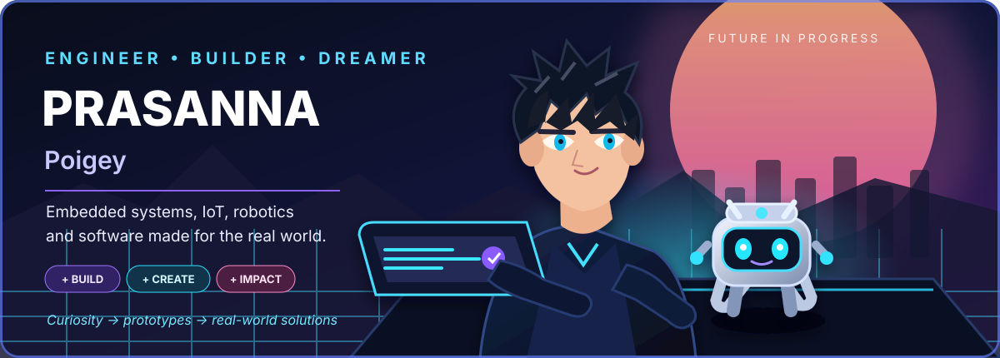
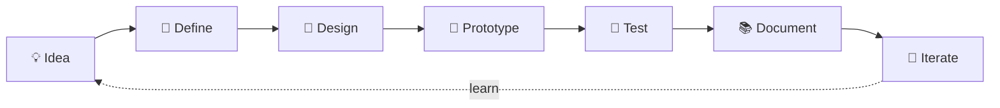

<!--
  Prasanna Poigey | Developer profile
  Repository: github.com/pojge2005/Prasanna-Profile
  Original anime-inspired artwork; no third-party anime character assets.
-->

# Hey, I'm Prasanna Poigey 👋

### Embedded Systems • IoT • Robotics • AI • Full-Stack Development

*I turn curious ideas into practical things that work — from tiny ESP32 devices to web experiences.*

[Explore Projects](https://github.com/pojge2005?tab=repositories) · [Connect on LinkedIn](https://www.linkedin.com/) · [Visit MiskFlow](https://www.miskflow.tech)

---

## ⚡ About Me

I'm an engineering-focused builder interested in the boundary between software and the physical world. I work on embedded firmware, IoT prototypes, robotics, automation, and web applications — learning by building, testing, documenting, and iterating.

- 🔧 **Embedded & firmware:** ESP32, Arduino, FreeRTOS, sensor integration, OLED interfaces
- 🤖 **Robotics & AI:** robotics workflows, computer vision, object tracking, automation
- 🌐 **Software:** web applications, APIs, dashboards, Android and business tools
- 🚀 **Startup:** building ideas and prototypes with **[MiskFlow](https://www.miskflow.tech)**
- 📍 **Based in:** Nagpur, Maharashtra, India
- 🌱 **Currently exploring:** RTOS architecture, OTA firmware, and practical AI-powered products

> **My approach:** prototype thoughtfully, keep systems modular, document what works, and never confuse an unverified feature with a tested one.

## 🧰 Technology Toolbox

### Embedded · Electronics · IoT

### Web · Software · Tools

**Hardware & platforms:** ESP32-C3 · ESP32-S3 · SSD1306 OLED · I²C · GPIO · sensors · battery-powered prototypes  
**Engineering practices:** modular firmware · non-blocking state machines · serial debugging · version control · architecture notes

## 🚀 Featured Builds

<table>
<tr>
<td width="50%" valign="top">

### 🔑 [SmartKeychain-V2](https://github.com/pojge2005/SmartKeychain-V2)

An ESP32-C3 based smart-keychain / mini-device project exploring a compact OLED interface, button navigation, small animations, and modular firmware.

**Focus:** ESP32-C3 · OLED · embedded UI · firmware

</td>
<td width="50%" valign="top">

### ⚙️ [ESP32-FreeRTOS-IoT](https://github.com/pojge2005/ESP32-FreeRTOS-IoT)

A project space for exploring task-based firmware structure and real-time IoT patterns on ESP32.

**Focus:** FreeRTOS · ESP32 · embedded systems

</td>
</tr>
<tr>
<td width="50%" valign="top">

### 🔐 [Two-Layer RFID Security System](https://github.com/pojge2005/Two-Layer-RFID-Security-System)

An RFID access-control project exploring layered authentication and hardware/software integration.

**Focus:** RFID · access control · Arduino / ESP32

</td>
<td width="50%" valign="top">

### 🎯 [Real-Time Object Tracking](https://github.com/pojge2005/Real-Time-Object-Tracking-System-Raspberry-Pi-OpenCV-)

A computer-vision project repository for real-time object-tracking experimentation with Raspberry Pi and OpenCV.

**Focus:** computer vision · OpenCV · Raspberry Pi

</td>
</tr>
</table>

## 📊 GitHub Snapshot

 

These cards are provided by external services and may occasionally be unavailable or lag behind GitHub. They reflect available public data, not a claim about work that has not been recorded.

## 🗺️ How I Build

## 🤝 Let's Build Something Useful

Interested in embedded devices, IoT systems, robotics, automation, or practical software? I’m open to learning with other builders, collaborating on meaningful projects, and sharing progress.

### *Build boldly. Stay curious. Make it real.* ✨

Designed with an original anime-inspired SVG hero and a developer-first layout.

